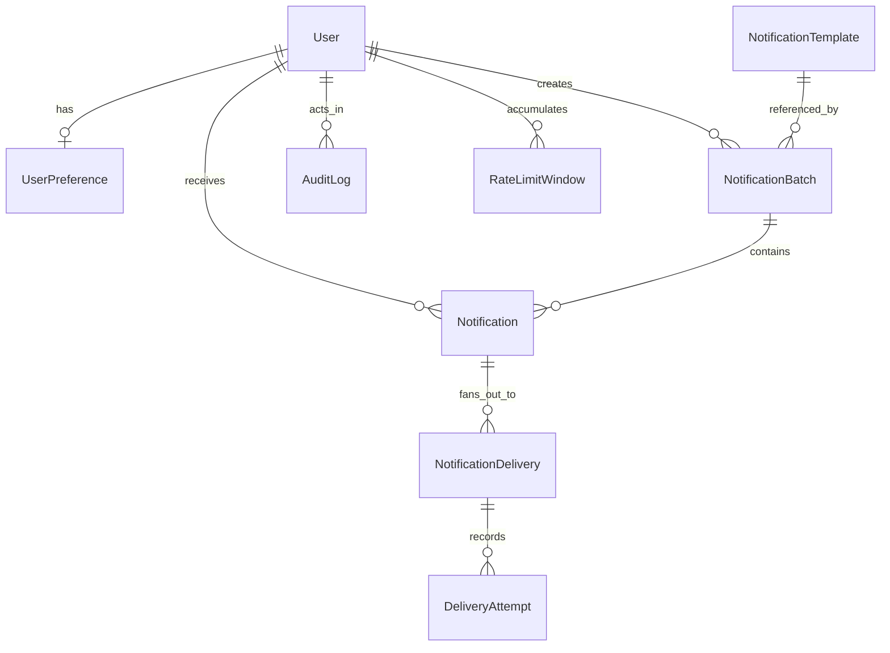

# Domain Model

## Entities

### `User`

- Schema/model: `prisma/schema.prisma` — `model User`
- Primary service owner: `src/services/authService.ts` for login/session shaping and `src/services/notificationService.ts` for recipient workflow decisions

### `UserPreference`

- Schema/model: `prisma/schema.prisma` — `model UserPreference`
- Primary service owner: `src/services/preferenceService.ts` via `getMyPreferences()` and `updateMyPreferences()`

### `NotificationTemplate`

- Schema/model: `prisma/schema.prisma` — `model NotificationTemplate`
- Primary service owner: `src/services/notificationService.ts` via `getNotificationComposerData()` and `createNotificationBatchForSession()`

### `NotificationBatch`

- Schema/model: `prisma/schema.prisma` — `model NotificationBatch`
- Primary service owner: `src/services/notificationService.ts` via `createNotificationBatchForSession()`

### `Notification`

- Schema/model: `prisma/schema.prisma` — `model Notification`
- Primary service owner: `src/services/notificationService.ts` via `listNotificationsForSession()`, `getNotificationDetailForSession()`, and `markNotificationOpenedForSession()`

### `NotificationDelivery`

- Schema/model: `prisma/schema.prisma` — `model NotificationDelivery`
- Primary service owner: `src/services/workerService.ts` via `processDueDeliveries()`

### `DeliveryAttempt`

- Schema/model: `prisma/schema.prisma` — `model DeliveryAttempt`
- Primary service owner: `src/services/workerService.ts` via `processDueDeliveries()` and repository helper `createDeliveryAttempt()`

### `RateLimitWindow`

- Schema/model: `prisma/schema.prisma` — `model RateLimitWindow`
- Primary service owner: `src/services/workerService.ts` via `reserveRateLimitSlot()` in `src/repositories/rateLimitRepository.ts`

### `AuditLog`

- Schema/model: `prisma/schema.prisma` — `model AuditLog`
- Primary service owner: `src/repositories/auditLogRepository.ts`, invoked from `src/services/notificationService.ts` and `src/services/preferenceService.ts`

## Relationship notes

- One `NotificationBatch` creates many `Notification` rows so batch-level monitoring is distinct from recipient-level delivery state.
- One `Notification` fans out into many `NotificationDelivery` rows so each channel can retry, fail, or open independently.
- `DeliveryAttempt` exists because retryable systems need historical evidence, not just a final status field.
- `RateLimitWindow` is separate from delivery rows because rate limiting is a per-user/per-channel aggregate concern, not a property of one delivery.
