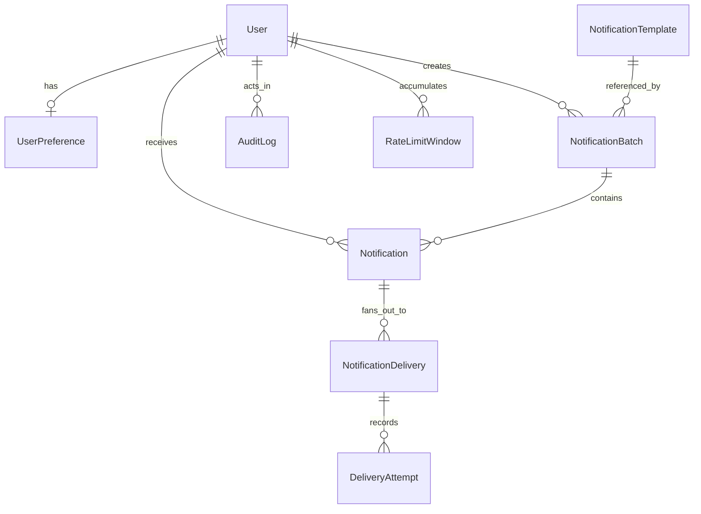

# Domain Model

## Entities

### `User`

- Schema/model: `prisma/schema.prisma` — `model User`
- Primary service owner: `src/services/authService.ts` for login/session shaping and `src/services/notificationService.ts` for recipient workflow decisions

### `UserPreference`

- Schema/model: `prisma/schema.prisma` — `model UserPreference`
- Primary service owner: `src/services/preferenceService.ts` via `getMyPreferences()` and `updateMyPreferences()`

### `NotificationTemplate`

- Schema/model: `prisma/schema.prisma` — `model NotificationTemplate`
- Primary service owner: `src/services/notificationService.ts` via `getNotificationComposerData()` and `createNotificationBatchForSession()`

### `NotificationBatch`

- Schema/model: `prisma/schema.prisma` — `model NotificationBatch`
- Primary service owner: `src/services/notificationService.ts` via `createNotificationBatchForSession()`

### `Notification`

- Schema/model: `prisma/schema.prisma` — `model Notification`
- Primary service owner: `src/services/notificationService.ts` via `listNotificationsForSession()`, `getNotificationDetailForSession()`, and `markNotificationOpenedForSession()`

### `NotificationDelivery`

- Schema/model: `prisma/schema.prisma` — `model NotificationDelivery`
- Primary service owner: `src/services/workerService.ts` via `processDueDeliveries()`

### `DeliveryAttempt`

- Schema/model: `prisma/schema.prisma` — `model DeliveryAttempt`
- Primary service owner: `src/services/workerService.ts` via `processDueDeliveries()` and repository helper `createDeliveryAttempt()`

### `RateLimitWindow`

- Schema/model: `prisma/schema.prisma` — `model RateLimitWindow`
- Primary service owner: `src/services/workerService.ts` via `reserveRateLimitSlot()` in `src/repositories/rateLimitRepository.ts`

### `AuditLog`

- Schema/model: `prisma/schema.prisma` — `model AuditLog`
- Primary service owner: `src/repositories/auditLogRepository.ts`, invoked from `src/services/notificationService.ts` and `src/services/preferenceService.ts`

## Relationship notes

- One `NotificationBatch` creates many `Notification` rows so batch-level monitoring is distinct from recipient-level delivery state.
- One `Notification` fans out into many `NotificationDelivery` rows so each channel can retry, fail, or open independently.
- `DeliveryAttempt` exists because retryable systems need historical evidence, not just a final status field.
- `RateLimitWindow` is separate from delivery rows because rate limiting is a per-user/per-channel aggregate concern, not a property of one delivery.
- `RateLimitWindow` has no Prisma relation to `User` (`prisma/schema.prisma:175-186`); the mermaid
  edge above is conceptual. Its `userId` is a plain string.

## Delivery status machine as implemented

`DeliveryStatus` (`schema.prisma:41-50`). Writers:

| From | To | Where |
|---|---|---|
| (new) | `QUEUED` or `SKIPPED` | `notificationService.ts:170-218` during batch creation |
| `QUEUED`, `RETRYING`, `RATE_LIMITED` (due, unlocked or stale-locked) | `PROCESSING` | claim SQL, `deliveryRepository.ts:33-40` |
| `PROCESSING` | `SENT` | `markDeliverySent`, `deliveryRepository.ts:93-113` |
| `PROCESSING` | `RETRYING` or `RATE_LIMITED` | `markDeliveryDeferred`, `:115-132` |
| `PROCESSING` | `FAILED` | `markDeliveryFailed`, `:134-153` |
| `SENT` | `OPENED` | `markDeliveryOpened`, `:155-168` |

`AttemptResult` (`schema.prisma:52-56`) records each worker attempt. Note that a rate-limit deferral
writes an attempt row (`workerService.ts:51-56`) but does not increment `attemptCount`
(`markDeliveryDeferred` has no increment), so `attemptNumber` can repeat for one delivery.

## Uniqueness that matters

- `NotificationDelivery @@unique([notificationId, channel])` (`schema.prisma:157`) — one row per
  channel per notification; the batch schema does not deduplicate `channels`, so a request with
  `["EMAIL", "EMAIL"]` would violate this inside the transaction and roll the whole batch back.
- `RateLimitWindow @@unique([userId, channel, windowStart])` (`:184`) — the conflict target for the
  upsert.
- `UserPreference.userId @unique` (`:76`) — at most one preference row per user.

**Exercise — Goal:** read the state machine. **Check:** find every place that writes `OPENED`
(expected: only `deliveryRepository.ts:164`) and every place that writes `PROCESSING` (expected:
only the claim SQL at `:35`).
